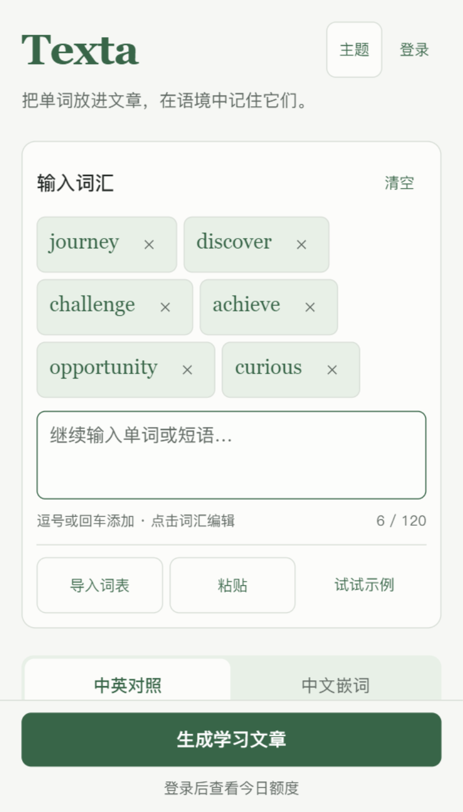

# Texta串词记 · 微信小程序

原生微信词汇学习客户端，与 [Texta 网页版](https://texta.yanyihan.top/) 共用账号、文章生成、用量及云端学习库。源码版本 **1.1.2**，使用 JavaScript、WXML、WXSS，运行代码没有 npm 依赖。

[返回项目首页](../README.md) · [共用后端配置](../docs/deployment.md) · [微信认证与账号关联](../docs/wechat-login.md)

## 功能

- 词汇标签编辑、短语输入、剪贴板粘贴、TXT / Markdown / CSV / JSON 导入，本地拼写建议与补全。
- 中英对照、中文嵌词和短文生成；保留输入草稿，生成失败不自动重复计费请求。
- 对应词汇高亮、词义抽屉、语境义项、常用释义、英美音标、搭配、近反义词及构词。
- 六套主题：浅色、深色、荧光、纸张、海洋、薰衣草；阅读字号设置。
- 收藏、生词本、掌握状态、搜索、来源文章及生词复习短文。
- 按账号隔离本机草稿和最近 30 篇生成历史；收藏等学习资料通过共用 API 同步。
- 微信快捷登录、首次创建免费账号；邮箱登录 / 注册、绑定新邮箱、验证原密码关联已有账号。
- PDF、可编辑 DOCX、TXT 和文章复制；标题、中文译文、页边距与纸白预览，附英文 / 词性 / 中文翻译词汇表。
- 套餐和今日用量、连接检查、原生服务条款和隐私政策页面。

小程序未包含网页语言切换、浏览器朗读、管理员控制台或站内支付；账号套餐和额度从后端读取。PDF 为画布生成的图片型文档，DOCX 为真正的 OOXML 可编辑文档。

<p align="center">
  
  
  
</p>

*已有模拟器截图，使用测试内容。*

## 在开发者工具中运行

1. 导入当前目录 `wechat-miniprogram/`，导入入口为 `project.config.json`；小程序运行目录为 `miniprogram/`。
2. 项目保留原 AppID `wxc1af567af0505b1e`。维护者使用原项目权限；其他开发者请使用自己的小程序配置，并匹配后端微信凭据。
3. 点击编译；不需要“构建 npm”。
4. `miniprogram/config.js` 默认连接 `https://api-texta.yanyihan.top`；调试自建后端时替换公共地址。
5. 微信登录要求服务端配置与客户端一致的 `WECHAT_APP_ID`、`WECHAT_APP_SECRET`。AppSecret、模型密钥和数据库密码仅存服务端。

真机需在公众平台配置 API 的 **request 合法域名**，并在启用域名校验后预览。开发者工具私有配置不进入仓库，关闭本地校验不能替代正式配置。政策、隐私指引和平台审核需按实际功能填写。

## 检查与编译

从仓库根目录：

```bash
npm run mini:check
npm run test:mini
```

这两项不需要安装小程序 npm 依赖。`check` 检查 JavaScript / JSON、页面文件、事件绑定、图标及 AppID；单元测试覆盖输入、阅读、导出、会话、微信 / 邮箱关联、同步失败、数据迁移和账号切换竞态。

安装模拟器自动化依赖后，可使用本机开发者工具：

```bash
npm ci --prefix wechat-miniprogram
npm run mini:compile
npm run devtools --prefix wechat-miniprogram
```

编译器与 CLI 默认沿用原本机安装位置，可在 Windows PowerShell 覆盖：

```powershell
$env:WECHAT_COMPILER_ROOT = 'D:\微信web开发者工具\code\package.nw\node_modules\wcc-exec'
$env:WECHAT_DEVTOOLS_CLI = 'D:\微信web开发者工具\cli.bat'
npm run mini:compile
```

小程序已带图标、政策和压缩词表，无需重新生成。可选维护脚本 `scripts/prepare-assets.py` 和 `scripts/pack-word-assist.py` 已改为读取同一仓库 `public/`，不依赖原作者的源码盘符；前者需要 Python / Pillow，后者只用 Python 标准库。

### 模拟器验收

开发者工具打开本项目并启用自动化后，在 `wechat-miniprogram/` 目录执行：

```bash
node scripts/workspace-smoke.cjs
node scripts/wechat-merge-smoke.cjs
```

`workspace-smoke` 检查输入、主题、词义抽屉以及真实 canvas / 文件系统导出；账号合并脚本使用模拟 API。通常连接 `9420`，部分脚本支持 `TEXTA_AUTO_PORT`。它们不替代真机验证。其他 `*-live-check.cjs` 会调用实际微信或后端接口，仅在明确需要真实账号验收时手动执行。

模拟器报告、预览二维码和编译产物保存在本地 `artifacts/`、`.impeccable/review/` 或系统临时目录，由 Git 排除。运行中断后，按对应脚本恢复本机测试状态；全流程恢复工具为 `scripts/reset-smoke.cjs`。

## 页面与文件

| 位置 | 内容 |
| --- | --- |
| `miniprogram/pages/index/` | 词汇输入、导入、拼写辅助和生成 |
| `miniprogram/pages/result/` | 双语 / 混合阅读、词义、收藏和导出 |
| `miniprogram/pages/library/` | 收藏、生词、历史、搜索和复习 |
| `miniprogram/pages/auth/` | 微信 / 邮箱认证与主动账号关联 |
| `miniprogram/pages/profile/` | 账号、套餐、用量和同步 |
| `miniprogram/pages/legal/` | 服务条款和隐私政策 |
| `miniprogram/components/` | 六主题选择与词义抽屉 |
| `miniprogram/utils/` | API、同步、阅读、词表、导出及布局 |
| `miniprogram/data/` | 政策与压缩词典；保留词典许可证 |
| `scripts/`、`tests/` | 编译检查、模拟器工具和功能测试 |
| `typings/`、`tsconfig.json` | 开发工具类型配置 |

## 账号和同步

微信首次登录可创建无邮箱免费账号。已有网页账号时，在「我的 → 账号设置 → 关联已有账号」输入原邮箱和原密码。后端验证成功后合并允许迁移的学习资料和使用额度，保留原邮箱账号套餐，撤销来源账号会话。付费来源账号、订单、冲突身份或超限资料会阻止自动合并，详见 [共用后端说明](../docs/wechat-login.md)。

客户端上传前读取并合并云端快照，保留文件夹、删除状态、掌握偏好和离线修改；上传失败不会清空本机资料。后端目前没有快照版本冲突接口，多设备同时上传仍有竞争窗口。生成历史仅本机保存，收藏后才能在其他设备通过云端读取。

## 发布状态与历史资料

本次仓库整理将原本分离的小程序完整源码纳入 Texta，保留原项目目录作为本机工作副本；**GitHub 更新不触发微信上传、审核或正式发布**。

2026-10-07 的记录：1.0.0 已发布并由用户确认；1.1.2 已上传和生成开发预览，待审核发布。当前公众平台状态未重新核验，以下文件保留为历史记录，不作为当前上线承诺：

- [1.1.2 发布记录](RELEASE-1.1.2-20261007.md)
- [微信登录](WECHAT-LOGIN-20261007.md)、[微信首次登录](WECHAT-FIRST-LOGIN-20261007.md)、[邮箱关联与合并](WECHAT-EMAIL-MERGE-20261007.md)
- [历史验证记录](VERIFICATION.md)
- [1.1.2 隐私补充材料](docs/privacy-disclosure-1.1.2.txt)
- [产品约束](PRODUCT.md)、[设计规范](DESIGN.md)

原始发布记录中提到的备份、模拟器报告和开发预览二维码保留在原本机项目中，不随 Git 仓库发布。正式发布需维护者在微信开发者工具上传，再到公众平台按实际状态提交审核和发布。
